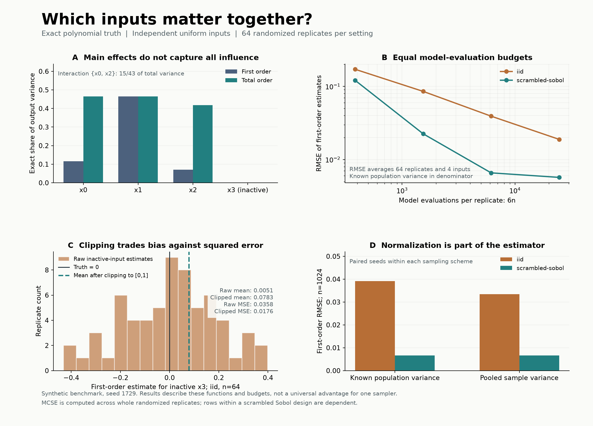

# Sobol Interaction Audit

[](https://github.com/lcx0731/sobol-interaction-audit/actions/workflows/ci.yml)

**A variable can have a weak main effect and still matter through interactions.**
This project implements first-order and total-order Sobol sensitivity estimates,
checks them against exact polynomial ANOVA, and compares iid Monte Carlo with
randomized Sobol integration at equal model-evaluation budgets. It also measures
what changes when a noisy estimate is clipped to its theoretical range.

The benchmark is a **deterministic, seeded synthetic experiment**. It uses no
external data, trained models, or private research. The aim is to demonstrate
experimental design, variance decomposition, numerical validation, and careful
reporting of simulation uncertainty.



## Reproduce

Python 3.11 or newer. CI runs the tests and full example on Python 3.11 and 3.13.
The committed outputs were generated locally with Python 3.13.

```bash
git clone https://github.com/lcx0731/sobol-interaction-audit.git
cd sobol-interaction-audit
python3 -m venv .venv
source .venv/bin/activate
python -m pip install -r requirements.txt
python -m pip install --no-deps .
python -m pip check
python -m pytest -q
python examples/demo.py --output results
sobol-audit --power 10 --repetitions 32 --scheme scrambled-sobol --normalization known
```

The example writes [metrics.json](results/metrics.json) and the figure above.
Use `--output /tmp/sobol-results` to preserve the committed files. The CLI audits
the fixed benchmark and prints JSON; `--normalization pooled` uses an estimated
variance instead of the known benchmark variance. There is no data download.
Direct dependencies are version-pinned in `requirements.txt`; pip resolves
their transitive dependencies for the Python version being used.

## Targets and assumptions

For a deterministic scalar model $Y=f(X)$ with **independent input coordinates**
and finite positive variance $V$, the two targets are

$$S_i=\frac{\operatorname{Var}(E[Y\mid X_i])}{V},\qquad
T_i=\frac{E[\operatorname{Var}(Y\mid X_{-i})]}{V}.$$

The first-order index measures the main effect. The total-order index includes
every interaction containing that variable. Consequently, first-order indices
can sum to less than one, while total-order indices can sum to more than one:
an interaction is counted in the total of each participating variable.

This is a distribution-dependent sensitivity analysis of a specified function.
It is not causal attribution, a test of a regression coefficient, or an
importance measure valid under arbitrary correlated inputs. The sampling API
uses independent Uniform[-1,1] coordinates; different marginals require an
explicit transformation inside the supplied function.

## Exact synthetic reference

With four independent Uniform[-1,1] inputs, use

$$f(x)=x_0+2x_1+3x_0x_2+\frac{3x_2^2-1}{2}.$$

The fourth input $x_3$ is inactive. The mean is zero and variance is $43/15$.

| Input | First order $S_i$ | Total order $T_i$ |
| --- | ---: | ---: |
| $x_0$ | $5/43$ ≈ 0.11628 | $20/43$ ≈ 0.46512 |
| $x_1$ | $20/43$ ≈ 0.46512 | $20/43$ ≈ 0.46512 |
| $x_2$ | $3/43$ ≈ 0.06977 | $18/43$ ≈ 0.41860 |
| $x_3$ | 0 | 0 |

The interaction between $x_0$ and $x_2$ contributes variance 1, or **15/43**
of the total variance. Looking only at main effects understates their influence.

The reference engine accepts a dictionary of ordinary monomial powers with
integer or rational coefficients. It computes uniform moments with
`fractions.Fraction`: odd powers have zero expectation, and an even power $k$
has expectation $1/(k+1)$. For each input subset, it integrates the other
coordinates, computes the variance of the resulting conditional polynomial,
then subtracts all proper-subset ANOVA components. Every resulting component
and normalized index is rational and exact.

This handles noncentered monomials correctly. For example, $x_0^2x_1^2$ contains
main effects as well as an interaction; simply assigning each monomial's entire
variance to the variables appearing in it would be wrong. “Exact” describes
this rational reference calculation. Model evaluations and sampling estimates
use floating-point arithmetic.

## Pick-freeze estimator

Draw two $n\times d$ matrices $A,B$. Hybrid $C_i$ is $A$ with **only column $i$**
replaced by column $i$ of $B$. With model evaluations $a=f(A)$, $b=f(B)$, and
$c_i=f(C_i)$, the implementation uses squared-difference estimates:

$$\widehat T_i=\frac{\frac1n\sum_r(a_r-c_{ir})^2}{2\widehat V},\qquad
\widehat S_i=1-\frac{\frac1n\sum_r(b_r-c_{ir})^2}{2\widehat V}.$$

The design requires exactly $n(d+2)$ scalar model evaluations, executed in
$d+2$ vectorized batches. The method follows
[Jansen (1999), *Analysis of variance designs for model output*](https://doi.org/10.1016/S0010-4655(98)00154-4).

Two denominators are available:

- **Known population variance:** isolates integration error in this benchmark.
  Under ideal iid sampling the estimates are unbiased. Such a denominator is
  generally unavailable in applied sensitivity analysis.
- **Pooled sample variance:** variance of the combined $2n$ evaluations from
  $A,B$, with `ddof=1`. Even when that variance estimator is unbiased for iid
  observations, a ratio using it need not be unbiased. QMC rows are dependent,
  so the iid sample-variance argument does not apply unchanged there.

The estimator preserves raw values, including negative first-order estimates
and total-order estimates above one. The total estimate for an exactly inactive
input is exactly zero when repeated model evaluations agree, while its
complement-based first-order estimate can still be noisy.

## Randomization and uncertainty

For iid integration, one NumPy PCG64 generator draws a joint $2d$-dimensional
design. For randomized QMC, one SciPy Sobol engine generates the joint design
with LMS+digital-shift scrambling, 52 bits, and `random_base2(power)`.
The columns are split into $A,B$. Points are not skipped, thinned, or optimized.
See the [pinned SciPy Sobol documentation](https://docs.scipy.org/doc/scipy-1.15.3/reference/generated/scipy.stats.qmc.Sobol.html).

The experiment uses seed 1729 and **64 whole-design randomizations** for every
setting. `SeedSequence.spawn` supplies distinct recorded child seeds. Within a
randomized Sobol design, rows are dependent; resampling them as if they were iid
would not reproduce this randomization experiment. Stability is measured across
independent replicates instead, as described in the
[SciPy QMC guide](https://docs.scipy.org/doc/scipy-1.15.3/reference/stats.qmc.html).

For replicate estimates $z_1,\ldots,z_R$, the report contains their mean, sample
standard deviation $s$, and **Monte Carlo standard error of the mean**
$s/\sqrt R$. This MCSE describes random variation of the replicate mean around
the estimator's expectation. It does not account for bias, model uncertainty,
input-distribution error, or numerical approximation. No coverage guarantee or
simultaneous confidence interval is claimed. Reusing child seeds across budgets
and normalizations makes those comparisons dependent; these are not extra
independent replicates.

## Observed results

The following values are rounded from the committed metrics. First-order RMSE
averages squared errors over the **64 individual replicates and four inputs**,
then takes the square root. It is not the error of the replicate mean. Both
methods use the known variance in this comparison.

| Rows per matrix $n$ | Evaluations per replicate | iid RMSE | Scrambled Sobol RMSE |
| ---: | ---: | ---: | ---: |
| 64 | 384 | 0.170935 | 0.120735 |
| 256 | 1,536 | 0.085377 | 0.022501 |
| 1,024 | 6,144 | 0.039150 | 0.006584 |
| 4,096 | 24,576 | 0.018889 | 0.005711 |

Randomized Sobol integration has lower observed error here, but its first-order
RMSE improves only slightly between the two largest budgets. The saved samples
include that behavior. This is one smooth polynomial and one set of scrambles,
not a universal speedup, monotone-error claim, or convergence-rate estimate.
The full JSON also records per-index errors, all replicate estimates, MCSE,
total-order errors, variance denominators, and evaluation counts.

At $n=1024$, pooled normalization gives first-order RMSE 0.033491 for iid and
0.006643 for scrambled Sobol. A known denominator therefore does not necessarily
minimize finite-sample MSE; it is useful here for isolating one source of error.
The main budget comparison and the pooled comparison each use equal model
evaluation counts across sampling methods; the reference calculation's work is
not included in the black-box evaluation count.

### Clipping is a different estimator

For the inactive input $x_3$, 28 of the 64 iid first-order estimates at $n=64$
are negative. The diagnostic compares the raw result with its projection to
`[0,1]`:

| Statistic, true index = 0 | Raw | Clipped |
| --- | ---: | ---: |
| Mean estimate / empirical bias | 0.005061 | 0.078322 |
| Mean squared error | 0.035820 | 0.017579 |

The clipped mean is farther from zero in this run, while squared error falls.
Indeed, projection onto `[0,1]` cannot increase squared error relative to any
truth in that interval. Clipping can be useful under that loss; it also changes
bias and the sampling distribution. This project retains the raw estimates so
that the integration error remains visible and reports clipping as an explicit
alternative, rather than silently modifying the output. It does not treat
every negative estimate as evidence of a coding error.

## API and validation

```python
from interaction_audit import draw_design, evaluate_design

def model(x):
    return x[:, 0] + x[:, 0] * x[:, 1]

a, b = draw_design(dimension=2, power=10, scheme="scrambled-sobol", seed=7)
estimate = evaluate_design(model, a, b)  # pooled normalization
print(estimate.first, estimate.total, estimate.evaluations)
```

The 27 tests cover exact benchmark components, noncentered monomials, independent
tensor Gauss–Legendre integration of conditional variances, complete enumeration
of pairs from a discrete cube, hybrid orientation, affine invariance, inactive
inputs, evaluation counts, reproducibility, replicate-level MCSE, invalid input,
and the installed CLI from outside the source directory. The iid/QMC sanity
checks have broad fixed tolerances; they do not require QMC to win on every run.

| Path | Purpose |
| --- | --- |
| `src/interaction_audit/core.py` | Design generation, estimators, replication |
| `src/interaction_audit/reference.py` | Exact rational polynomial ANOVA |
| `src/interaction_audit/cli.py` | Reproducible benchmark command |
| `examples/demo.py` | Sampling, normalization and clipping comparisons |
| `tests/` | Independent references and failure cases |
| `results/` | Synthetic metrics and figure |

The sampling API is limited to 1–32 inputs, $n=2^m$ with $1\le m\le16$, 2–256
replicates, and at most 20 million evaluations per replicated call. The reference
engine is intentionally smaller: at most six variables, 64 monomials, and degree
eight per coordinate. Its cost grows exponentially with dimension. Low-level
evaluation functions cannot infer whether an externally supplied design obeys
independence or whether the model is deterministic. Constant-output cases with
estimated zero variance are rejected. Scalar settings use built-in Python
integers/floats; coefficients use integers or `Fraction` values.

Dependent inputs, stochastic simulators, fitted-model uncertainty, discontinuous
high-dimensional performance guarantees, and automatic marginal estimation are
outside scope. Floating-point evaluation, finite-bit pseudorandom designs, and
changes in library versions can affect the last digits. This implementation is
an original educational study of established methods, not a new estimator.

Released under the [MIT License](LICENSE).
